<p align="center">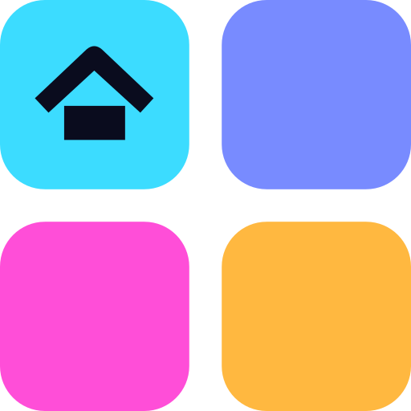</p>

<h1 align="center">ThemeHub</h1>

<p align="center">Console-style home screens for the Steam Deck: PlayStation, Xbox and Nintendo looks, a theme Hub, theme-file importers and Plugin Spotlight. A <a href="https://github.com/SteamDeckHomebrew/decky-loader">Decky Loader</a> plugin.</p>

<p align="center"><a href="https://github.com/Kaal31/benderthemes/releases/latest"><b>Download the latest release</b></a></p>

ThemeHub was previously called **Deck Home Themes** (and, as a repository, Bender Themes). The release ZIPs keep the `DeckHomeThemes-vX.Y.Z.zip` name so existing installs update normally.

## Gallery

Browser previews with a sample library (not recorded on a Deck).

| | | |
| :---: | :---: | :---: |
| 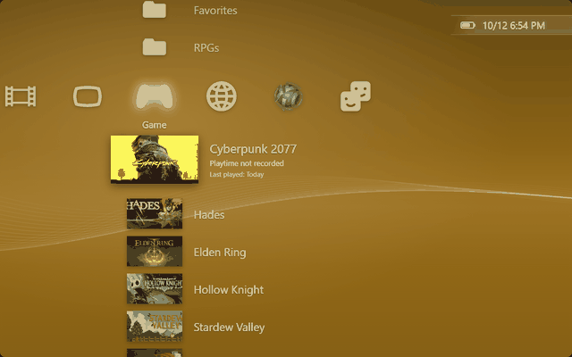<br>PS3 XMB | 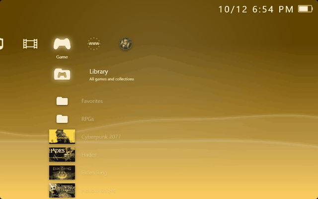<br>PSP XMB | 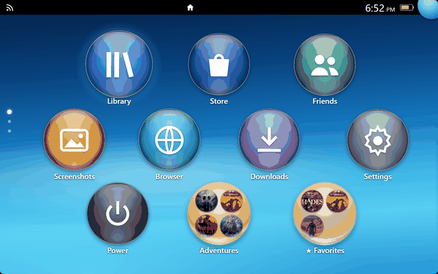<br>PS Vita |
| 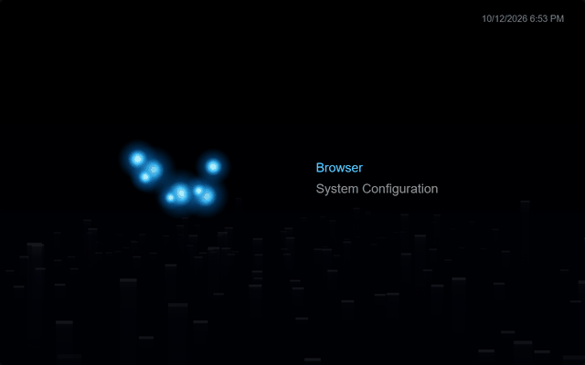<br>PS2 | 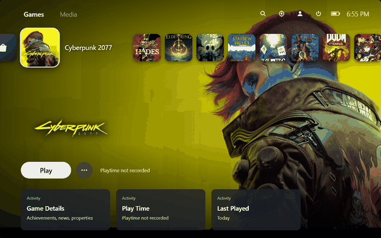<br>PS5 | 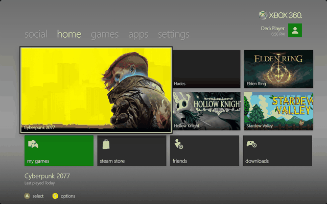<br>Xbox 360 |
| 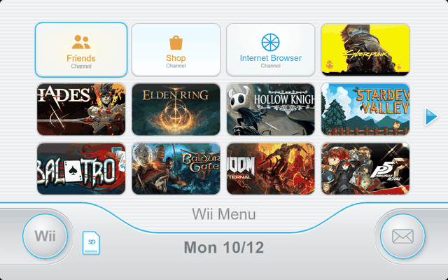<br>Wii | 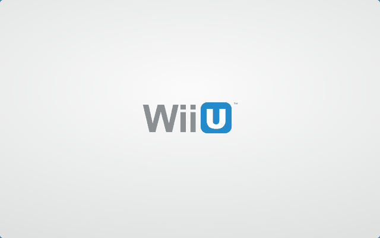<br>Wii U | 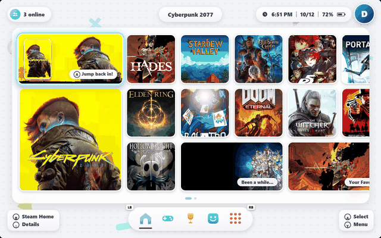<br>iiSU style |
| 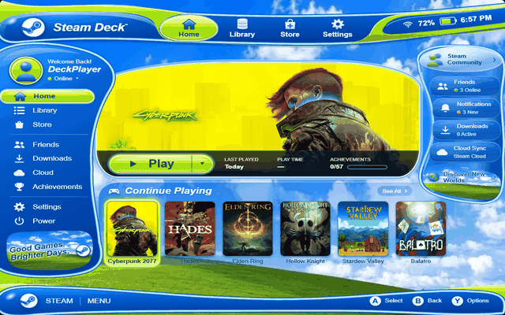<br>Aero v.2 | 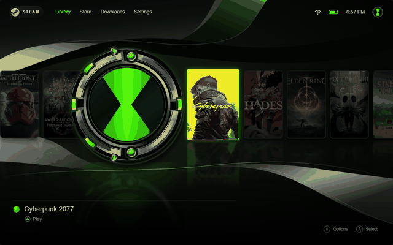<br>Alien Dial | 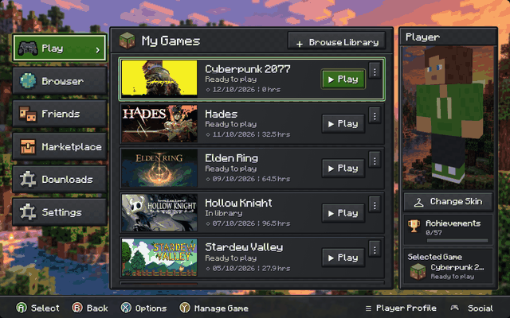<br>Block Worlds |

## Themes

| Collection | Looks |
| --- | --- |
| PlayStation | PS1, PS2 browser, PS3 XMB, PSP XMB, PS4, PS5, PS Vita bubbles and LiveArea |
| Nintendo | Wii channels, Wii U (grid and Wara Wara Plaza), Switch, Nintendo 3DS |
| Xbox | Original Xbox, Xbox 360 Blades, NXE, Kinect and Metro dashboards |
| Bonus | Aero, Aero v.2, Alien Dial, Floating Castle, Republic Office, Block Worlds, Six Paths, Nazarick, iiSU style |

Wii, Wii U, Switch, 3DS, PS1 and iiSU style come with the plugin. The other themes are downloaded one by one from the Hub, so you only keep what you use.

## What's inside

- **Hub:** browse every theme with animated previews, download, activate or delete it. The Hub can wear the look of the theme you came from (Auto), the theme focused in Discover (Preview), a fixed theme, or stay Neutral.
- **Theme files:** search and download real console theme files (PS3 `.p3t`, PSP `.ptf`/`.ctf`, Vita, Switch `.nxtheme`, Wii, Xbox and more) from public sources, or add your own.
- **Plugin Spotlight:** a hand-picked list of Decky plugins plus a search over every public Decky plugin, with installs handed to Decky for confirmation.
- **Presets and switching:** every look, imported theme file and saved preset is a preset. Hold L1 and use the D-pad to switch console or preset; L2 / R2 step through all presets; Quick Access lists the downloaded looks.
- **Themed extras:** a store, library and search pages styled like each console, themed loading screens, sound packs and background music, Steam keyboard skins, and update notices in each console's own style.

## Install

1. Install and enable Decky Loader on your Steam Deck.
2. Download the latest **DeckHomeThemes-vX.Y.Z.zip** from the [Releases page](https://github.com/Kaal31/benderthemes/releases/latest) and copy it to your Deck.
3. Enable Decky's developer options, then use **Install Plugin from ZIP** and pick the archive.
4. Open **ThemeHub** in Quick Access. The first-run setup lets you pick a theme; the Hub downloads it.

Later versions are offered inside the plugin (Quick Access and an update notice on the home) and installed through Decky. Settings and downloaded themes are kept across updates. Do not use GitHub's automatic source ZIP as the install package.

## Your own theme files

Put theme files in the plugin's skins folder (the path is shown in Quick Access), or download them from the Hub's Theme files tab:

| Folder | Files |
| --- | --- |
| `skins/p3t` | PS3 `.p3t`: background, icons, sound effects, slideshows |
| `skins/psp` | PSP `.ptf` and custom-firmware `.ctf`: wallpaper, icons, sounds, animated backgrounds and the 3D wave |
| `skins/vita` | PS Vita theme folder or `.zip` with `theme.xml`: wallpapers, bubbles, colours, lock screen, music |
| `skins/switch` | Nintendo Switch `.nxtheme` |
| `skins/wii` | Wii `.mym` / `.csm` |
| `skins/wiiu` | Wii U `.utheme` |
| `skins/3ds` | Nintendo 3DS themes (`.zip`, folder or `body_LZ.bin`) |
| `skins/xbox` | Original Xbox skins |
| `skins/x360` | Xbox 360 theme packages |

Vita theme music is ATRAC9. Playing it needs the free [vgmstream](https://github.com/vgmstream/vgmstream) decoder, which is not bundled; Quick Access offers to download its official Linux build once. The Vita lock screen is visual only: Steam's own PIN still protects the Deck.

## Build from source

Requires Node.js with npm and Python 3.

```sh
npm ci
npm run typecheck
npm run build
npm run package
```

The installable archive is written to `out/DeckHomeThemes-v<version>.zip`.

Browser previews: `npm run preview`, then serve the folder (`python -m http.server 8766`) and open `http://127.0.0.1:8766/preview/preview.html`. Previews use sample games and mock Steam services. Playwright checks in `tests/` use the same previews.

## Releases

Every push to `main` is checked, built and packaged by GitHub Actions; a successful build publishes the next numbered release, which the plugin then offers as an update. Theme packs and the Hub's preview gallery are published separately on [Kaal31/deckthemes-assets](https://github.com/Kaal31/deckthemes-assets).

## Current limits

Most features are checked with browser previews, type checks and builds; behaviour on a Deck (controller handling, Steam's keyboard, performance) still needs on-device testing. These are console-inspired reconstructions, not original console software, and make no claim of exact visual parity. Floating Castle weather is opt-in and uses approximate IP location (ipwho.is) and current conditions (Open-Meteo).

## Credits

ThemeHub is built on the work, art, sounds and research of many people. Thank you all.

### Inspiration

- **[justinca92 — SpinDeck](https://github.com/justinca92/spindeck)**, which inspired this plugin and was a reference during development.
- **SLSDeck**'s numbered-release updater, which ThemeHub's own updater was adapted from.
- The original **Deck Home Themes** plugin: its BSD-3-Clause notice is kept in [third-party/Original-Deck-Home-Themes-BSD.txt](third-party/Original-Deck-Home-Themes-BSD.txt).

### Theme art and references

| Creator / project | Used for |
| --- | --- |
| [MrMilenko — Theseus](https://github.com/MrMilenko/Theseus) (GPL-3.0) | Original Xbox dashboard reference, orb art and textures |
| Team Blackbolt — MC360 2.1 skin | Xbox 360 Blades textures and font |
| [thedev0ps — Xbox 360 Dashboard Archive](https://github.com/thedev0ps/Xbox-360-Dashboard-Archive) | Xbox 360 Blades, NXE, Kinect and Metro dashboard resources |
| [Fabxx — XBMC360](https://github.com/Fabxx/XBMC360) | Xbox 360 Blades reference |
| esseti (DeviantArt) — PlayStation 3 XMB icons | PS3 XMB icons |
| DeviantArt creators and other PSP references | PSP icons and visual references |
| [Libretro — RetroArch Assets](https://github.com/libretro/retroarch-assets) | Interface assets and icons |
| [Saud — PS2-inspired browser](https://www.imsaud.me/browser) | PS2 interface reference |
| [Warren Uhrich — SAO UI](https://warrenuhrich.github.io/SAO-UI/) | Floating Castle animation reference |
| [kmturley — Cover Forge](https://github.com/kmturley/cover-forge) (CC0-1.0) | Reference for 3D game cases, sleeves, spines and gloss |
| [TheRensei — SteamDeckCSSThemes](https://github.com/TheRensei/SteamDeckCSSThemes) (MIT) | Game-cover reflection reference |
| [VitauMX — vita-ui](https://github.com/VitauMX/vita-ui), [uofw](https://github.com/uofw/uofw), [pauliquib — Vlnky](https://github.com/pauliquib/Vlnky) | Vita presentation, PSP research, PSP wave model layout (reference only, no code copied) |
| [seatann-dev — decky-wall](https://github.com/seatann-dev/decky-wall) | Video-wallpaper ideas |
| the iiSU emulation frontend | Inspiration for the iiSU style look (drawn from scratch, no iiSU artwork) |

### Sound packs and music

| Pack | Creator |
| --- | --- |
| Original Xbox sound and music packs | Ollum |
| Theseus Xbox Dashboard sounds | Team UIX (Theseus) |
| Xbox 360 UI | calencyr |
| Xbox 360 dashboard sounds | Microsoft (extracted) |
| MC360 Blades sounds | Team Blackbolt |
| PS2 System Sounds | Junomede |
| PS2 Ambience | superfluid-cs |
| PS3 Menu Music | plumber-craic |
| PS4 sounds | Midnight |
| PlayStation 4 Home Menu | kobacat |
| PS5 sounds | theamanproject |
| PSP Sounds | SGL-Galaxy |
| PS Vita SFX | trollfacegaming420 |
| PS Vita Menu | Starlogical |
| Wii U SFX | Creeper Of Doom#5959 |
| Wii U Friends, Settings and Download Management music | Haxorzz |
| iiSU SFX | DreamerSouls |
| Windows XP sounds (Aero) | cadecomposer |
| Minecraft Console Legacy (Block Worlds) | Gecked#0108 |
| SAO sounds (Floating Castle) | Who!#6464 |
| Classic Battlefront Menu SFX (Republic Office) | [EldeBH / Florisvdwetering](https://www.nexusmods.com/starwarsbattlefront22017/mods/2673?tab=description); Palpatine Suite supplied by Jorah the Andal |
| Sweden — C418 (Block Worlds) | user-supplied recording |
| Crossing Fields, instrumental remix — Half Ghoul Music (Floating Castle) | user-supplied recording |
| No Man’s Dawn, instrumental — Mayu Maeshima (Nazarick) | user-supplied recording |
| Girei, Pain’s Theme Song — Action X Now (Six Paths) | user-supplied recording |

Many packs come from the [DeckThemes](https://deckthemes.com/) community. PlayStation sounds belong to Sony, Xbox sounds to Microsoft. The Alien Dial sounds are synthesised for this plugin.

### Fonts

| Font | License |
| --- | --- |
| [Aurek Fonts](https://github.com/AurekFonts/AurekFonts.github.io) — Aurebesh AF, Aurebesh English (Republic Office) | free for personal and commercial use; Rodian under MIT |
| [Cinzel](https://github.com/NDISCOVER/Cinzel) and [Cormorant](https://github.com/CatharsisFonts/Cormorant) (Republic titles and text) | SIL OFL 1.1 |
| Share Tech | SIL OFL 1.1 |
| [The League of Moveable Type — Orbitron](https://github.com/theleagueof/orbitron) | SIL OFL 1.1 |
| [South-Paw — typeface-minecraft](https://github.com/South-Paw/typeface-minecraft) (Block Worlds) | see its repository |

### Code and data

| Project | Used for |
| --- | --- |
| [Decky Loader](https://github.com/SteamDeckHomebrew/decky-loader) | the plugin platform |
| [bs-community — skinview3d](https://github.com/bs-community/skinview3d) and skinview-utils | the live Minecraft player in Block Worlds |
| [three.js](https://github.com/mrdoob/three.js) (MIT) | 3D rendering |
| [Simple Icons](https://github.com/simple-icons/simple-icons) (CC0-1.0) | the Steam mark |
| [vgmstream](https://github.com/vgmstream/vgmstream) | decoding Vita theme music and the supplied Battlefront sounds |
| [safetzahirovic — Decky Plugins Explorer](https://safetzahirovic.github.io/decky-plugins-explorer/) | the plugin list behind Plugin Spotlight's search |
| [Themezer](https://themezer.net), [PSPunk](https://www.pspunk.com), [Internet Archive](https://archive.org), [PS3-Pro/Themes](https://github.com/PS3-Pro/Themes), [Shenron0/PSP-Themes](https://github.com/Shenron0/PSP-Themes), [Acemad/VitaShell-Themes](https://github.com/Acemad/VitaShell-Themes) | the sources the Theme files tab searches; every theme file stays its creator's work |

Plugin Spotlight credits each plugin's author on its own page.

### Notices

Bundled third-party notices are kept in [third-party/](third-party/) and next to the resources (`SOURCES.txt`, `SOURCE.txt`, `Copyright`). The Nazarick category wallpapers were generated from a supplied visual reference; Overlord characters and setting belong to their rights holders. PlayStation, Xbox, Nintendo, Wii, Steam and the other console and product names are trademarks of their owners; ThemeHub is a fan project and is not affiliated with or endorsed by them.

No project-wide license is added by this repository.

## Build a community theme

See the [custom theme author guide](docs/CUSTOM-THEMES.md) for a working starter, multi-page navigation, 3D interfaces, saved data, controller input, live Steam services, packaging and Hub publishing status. The [frame SDK reference](docs/FRAME-SDK.md) describes the experimental bridge API.

Try the [interactive community-theme starter](themes/community-starter/README.md) for labeled lessons and working demos inside an installable theme.
